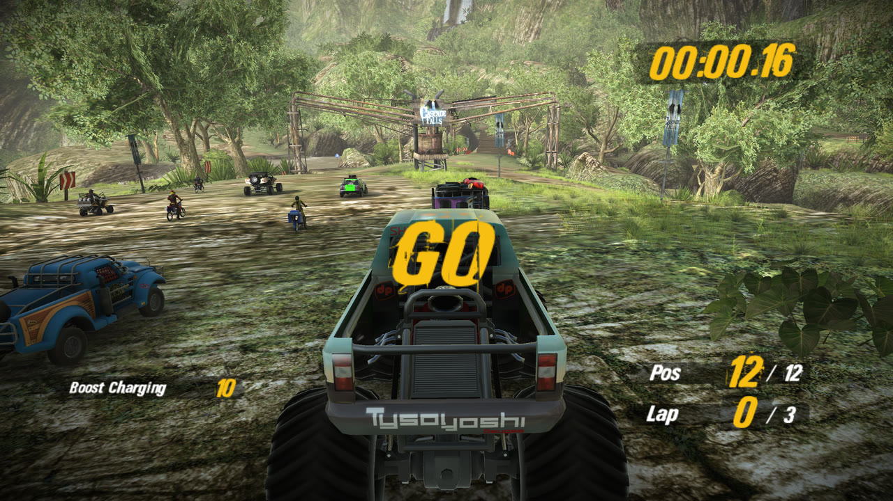
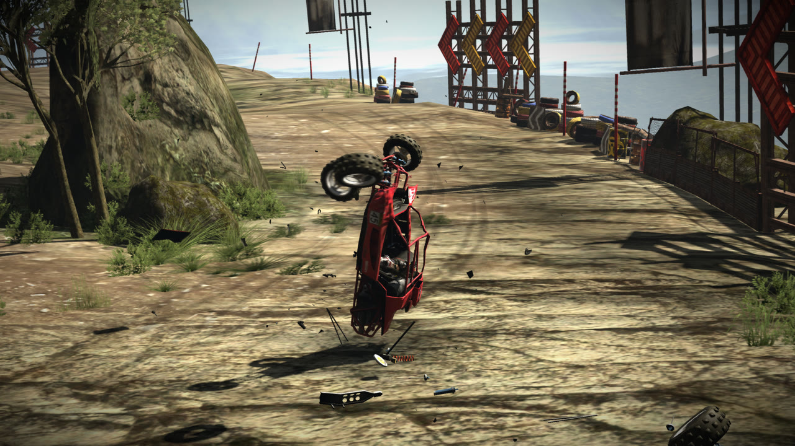
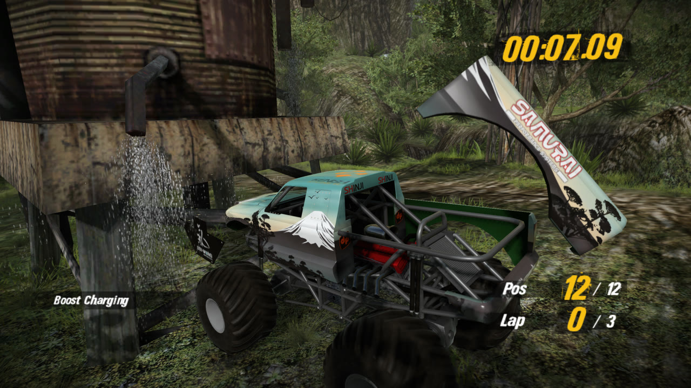
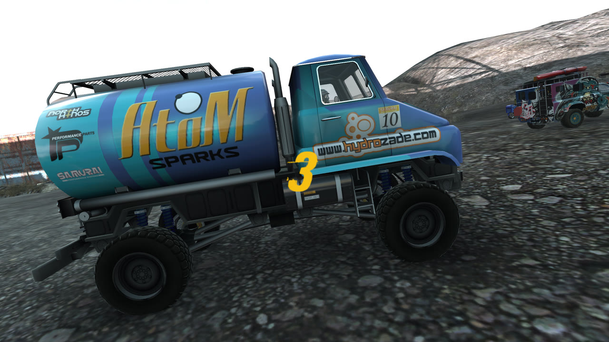
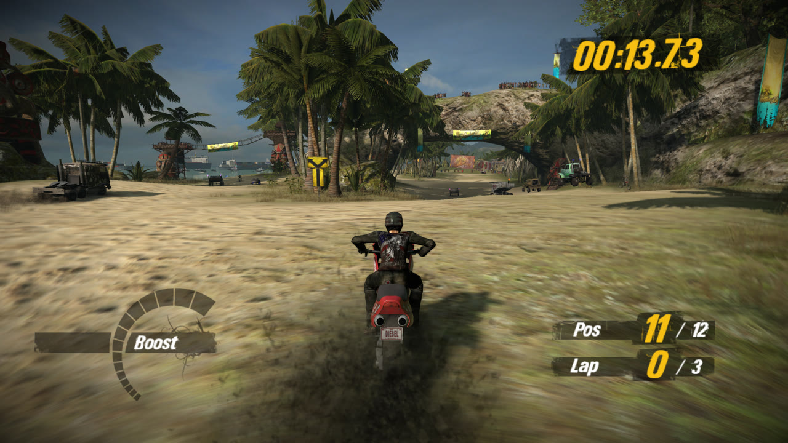

<h1 align="center">MotorStorm: Pacific Rift — native PC port (Linux, Vulkan)</h1>

<p align="center">
  
  
  
  
  
</p>

<p align="center"><b>motorstorm-pacific-rift-pc</b> · native on Linux · PS3 static recompilation · Vulkan · up to 4K · optional 60 fps</p>

<p align="center"></p>

**MotorStorm: Pacific Rift** (PS3, BCES-00129, version 01.00) running natively
on Linux, without an emulator. The game's code, PowerPC (PPU) and SPU, is
translated to C ahead of time by static recompilation with
[ps3recomp](https://github.com/sp00nznet/ps3recomp) and compiled into a
normal x86-64 program. The PS3 system is reimplemented by the toolkit's
runtime, and the GPU (RSX) runs the game's own shaders translated to Vulkan.

<p align="center">
  
  
</p>
<p align="center">
  
  
</p>
<p align="center"><i>Cascade Falls, Rain God Spires, Caldera Ridge and Kanaloa Bay at 1440p in 60 fps mode (shown here scaled to 1280×720).</i></p>

> [!IMPORTANT]
> **No game files come with this project, and none may be added to it.** To
> play you must own the game and dump it from your own PS3. The build turns
> **your** executable into code on **your** machine; that code, like the game
> data, is the game's and cannot be distributed. This repository holds only
> the port's own code, scripts and a patch to the toolkit.

## Status

| Area | State |
|---|---|
| Lift (39,469 PPU functions; 9 SPU ELFs, the WWS policy module, 31 job modules) and link | ✅ |
| Boot, intro FMV (Bink on SPU), first-run driver select, menus | ✅ |
| Free-Play races: rendering, AI, HUD, Havok physics on SPU, race results | ✅ |
| Audio (MultiStream, 7.1 folded to the output device) | ✅ |
| Game speed: 30 fps, as the game ships | ✅ correct speed, holds 30 fps |
| 60 fps mode (opt-in, game timestep patched, correct speed) | ✅ holds 60 fps in races at 1440p; dips in the slow-motion crash replay |
| Render scale (720p / 1440p / 4K) and AMD FSR 1 upscaling | ✅ |
| In-game menu (F1), performance HUD (F10), settings file | ✅ |
| Pad (SDL2 game controller) | ✅ |
| Saves, other modes and tracks | 🔧 not checked end to end |
| Online play | ❌ not planned (the servers are gone) |
| Windows / macOS | ❌ this port builds the toolkit's Linux-only Vulkan backend |

Measured on a Ryzen 9 5950X with an RTX 3090 on Linux. **Known issue:** in 60
fps mode the frame rate dips in the crash camera's slow-motion replay, where
the game's SPU physics jobs fill every job lane (see
[docs/NOTES.md](docs/NOTES.md), *Performance*).

Technical notes: [docs/NOTES.md](docs/NOTES.md).

## Requirements

**Game files** (details: [docs/REQUIRED_FILES.md](docs/REQUIRED_FILES.md)):

- Your own dump of **MotorStorm: Pacific Rift, BCES-00129 (Europe), version
  01.00**: the whole `PS3_GAME/` folder.
- Its `EBOOT.BIN` decrypted to `EBOOT.elf`, for example with RPCS3
  (*Utilities → Decrypt PS3 Binaries*). `scripts/lift.sh` checks its SHA-256;
  other regions and versions are not supported (the port patches the game at
  fixed addresses).
- The PS3 firmware installed in RPCS3 (*File → Install Firmware*), which
  provides the `dev_flash` the game reads.

**PC:**

- Linux x86-64. The lifted code is built for `x86-64-v3` (AVX2/FMA) by
  default; set the CMake cache variables `PORT_PPU_ARCH` and `PORT_SPU_ARCH`
  empty for an older CPU.
- A Vulkan GPU and driver (developed on NVIDIA).
- Plenty of RAM and time for the first build: the lift is tens of large C
  files. `scripts/build.sh` defaults to 14 jobs inside an 80 GB memory scope;
  lower `JOBS` (and `PORT_BUILD_MEM`) on a smaller machine.
- Tools and libraries: `git`, `rsync`, CMake 3.20+, Ninja, Clang (clang-20 is
  preferred when installed), Python 3.10+, and the development packages of
  SDL2, the Vulkan headers and glslang. On Debian/Ubuntu, for example:

  ```sh
  sudo apt install git rsync cmake ninja-build clang python3 python3-venv \
      libsdl2-dev libvulkan-dev glslang-dev glslang-tools spirv-tools
  ```

  `ffmpeg` is only needed by the test scripts in `work/tools/`.

## Setup

### 1. Get the code

```sh
git clone https://github.com/millennium-h4x0r/motorstorm-pacific-rift-pc.git motorstorm_pacific
cd motorstorm_pacific
scripts/install-hooks.sh    # optional: blocks commits of game files
```

### 2. Put the game in place

`disc/` is git-ignored. The port expects:

```
disc/PS3_GAME/            PARAM.SFO, ICON0.PNG, ... (links into your dump are fine)
disc/PS3_GAME/USRDIR/     the dump's USRDIR files, plus:
    EBOOT.elf             your decrypted executable
    ms2.psarc             one file; join a FAT32 dump's ms2.psarc.66600..66604 pieces in order
```

[docs/REQUIRED_FILES.md](docs/REQUIRED_FILES.md) has the exact commands
(symlinks for everything, a copy of `EBOOT.elf`, and the `cat` that joins
`ms2.psarc`) and the expected checksum.

### 3. Get and patch the toolkit

```sh
scripts/setup.sh
```

This clones ps3recomp into `ps3recomp/` (its own git repository, ignored by
this one), checks out the pinned commit (v0.18.0, `4e8f3ca8`), applies this
port's changes from `work/patches/ps3recomp.patch`, clones Dear ImGui v1.91.5
for the menu, and installs the toolkit's Python tools into `.venv/`. Set
`PS3RECOMP_DIR=<dir>` to keep the toolkit elsewhere (every script honours it).

### 4. Lift your executable

```sh
scripts/lift.sh                 # or: scripts/lift.sh path/to/EBOOT.elf
```

This translates the PPU code into `work/src/recomp/` and the SPU images into
`work/port/spu/` (`work/tools/lift_spu.sh`). It then runs
`work/tools/patch_lift.py`, which splices the port's hooks into the lifted
code: the 60 fps timestep, the frame-time compensation and the camera-shake
hooks. Both directories are git-ignored and must never be shared. After
updating this repository, run `scripts/lift.sh` again, or at least
`.venv/bin/python work/tools/patch_lift.py` (it is idempotent and fails
loudly if the lifted code is not what it expects).

### 5. Build

```sh
scripts/build.sh                # -> work/port/build/PacificRiftRecomp
```

This configures `work/port/CMakeLists.txt` with Ninja, a Release build and the
Vulkan backend, and builds it. It accepts `JOBS=<n>`, `PORT_BUILD_MEM=<size>`,
`BUILD_DIR=<dir>`, `SPU_DIR=<dir>`, `CC=`/`CXX=`. To run CMake yourself:

```sh
cmake -S work/port -B work/port/build -G Ninja -DCMAKE_BUILD_TYPE=Release \
    -DPS3RECOMP_DIR="$PWD/ps3recomp" -DRECOMP_DIR="$PWD/work/src/recomp" \
    -DSPU_DIR="$PWD/work/port/spu" -DPS3RECOMP_RSX_VULKAN=ON \
    -DPython3_EXECUTABLE="$PWD/.venv/bin/python"
cmake --build work/port/build
```

### 6. Play

```sh
work/run.sh
```

`work/run.sh` sets up the environment (the `dev_flash` path, `hdd0/` for
saves), runs `work/port/build/PacificRiftRecomp` on
`disc/PS3_GAME/USRDIR/EBOOT.elf` and logs to `work/runs/<time>.log`
(`work/runs/latest.log` points at the newest). The game opens a window;
`work/run.sh --offscreen` renders offscreen instead (the test scripts' `INST`
instances are offscreen by default). Arguments of the form `VAR=value` are
exported to the game.

Use an SDL2-supported game controller. The game ignores SIGINT (Ctrl+C); stop
it with SIGKILL, for example `pkill -KILL -x PacificRiftReco`.

## Settings

### In-game menu and keys

| Key | Action |
|---|---|
| **F1**, or Select+Start held half a second | Port menu (Escape closes it); the game sees a neutral pad while it is open |
| **F10** | Performance HUD: detailed, compact, off |
| **F11** or **Alt+Enter** | Full screen and back |

Every menu change is saved to `user/settings.ini` at once. The upscaler and
its sharpness apply immediately; the resolution scale and frame rate are read
at start, and the menu has a *Restart now* button for them. The frame keeps
its 16:9 shape in any window size, with black bars where needed.

### user/settings.ini

Read by windowed runs only (`$PS3_USER_DIR/settings.ini` if that is set). An
environment variable that is already set wins over the file.

```ini
[video]
fullscreen = 0
scale = 1            ; 1 = 720p, 2 = 1440p, 3 = 4K render targets (restart)
upscaler = off       ; off, or fsr (AMD FSR 1 to the window's size)
fsr_sharpness = 0.80 ; 0..1, 1 = sharpest
fps = 30             ; 30 (original) or 60 (restart)

[performance]
fps_counter = 1      ; HUD: 0 = off, 1 = detailed, 2 = compact
```

### Environment variables

The ones a player may want (all `PS3RECOMP_*` switches are read at start):

| Variable | Effect |
|---|---|
| `PS3RECOMP_VK_WINDOW=0` | Render offscreen, same as `--offscreen` (default: a window, which reads `user/settings.ini`) |
| `PS3RECOMP_VK_FULLSCREEN=1` | Start full screen |
| `PS3RECOMP_STRETCH=1` | Stretch the frame to the window (default: keep its shape, black bars) |
| `PS3RECOMP_RES_SCALE=1..4` | Render-target scale: 2 = 1440p, 3 = 4K |
| `PS3RECOMP_FSR=1`, `PS3RECOMP_FSR_SHARPNESS=0..1` | AMD FSR 1 upscaling to the window's size |
| `PS3RECOMP_FPS=60` | 60 fps mode at correct game speed while it holds 60 (needs the `patch_lift.py` hooks) |
| `PS3RECOMP_DT_MAX=2` | 60 fps mode: a late frame makes up the lost time (default 1, off: every frame is 1/60 s, so the game runs slightly slow below 60 fps; the catch-up makes the car lurch and riders fall) |
| `PS3RECOMP_CAMERA_SHAKE=1` | Keep the game's camera shake (default: off, a steady camera at both 30 and 60 fps) |
| `PS3RECOMP_SHAKE_60=1` | With camera shake on, 60 fps mode: step it every frame (stronger shake) |
| `PS3_DEV_FLASH=<dir>` | Firmware `dev_flash` (run.sh default: `~/.config/rpcs3/dev_flash`) |
| `PS3_HDD0_ROOT=<dir>` | Save data (run.sh default: `hdd0/`) |
| `PS3_USER_DIR=<dir>` | Where `settings.ini` and `shader_cache/` live (default `user/`) |
| `PS3RECOMP_SPIRV_CACHE=<dir>` or `0` | Translated-shader cache (default `user/shader_cache`) or none |
| `PS3RECOMP_FLIPLOG=<file>` | Log a timestamp per presented frame (`work/tools/fliplog.py` reads it) |

The port also changes some toolkit defaults for speed (`work/port/main.cpp`).
Two of them deviate from the PS3 and are the first thing to turn off when
something looks wrong: `SPURS_HOST_SPUS=5 SPURS_MAXCONT_MIN=1` restores
hardware SPU job scheduling. The rest, and the diagnostic switches, are
described in [docs/NOTES.md](docs/NOTES.md).

## Repository layout

| Path | What |
|---|---|
| `work/port/` | The port: `main.cpp` (boot, frame clock, defaults), `port_patches.cpp` (hooks called from the lifted code), `settings.cpp`, `ui.cpp`, `spu_fastpaths.c`, `CMakeLists.txt` |
| `work/patches/ps3recomp.patch` | This port's changes to ps3recomp (regenerate with `scripts/make_patch.sh`) |
| `work/tools/` | Lift helpers, test drivers and profilers ([work/tools/README.md](work/tools/README.md)) |
| `work/run.sh` | Run the game, or isolated test instances (`INST=<name>`) |
| `scripts/` | `setup.sh`, `lift.sh`, `build.sh`, `make_patch.sh`, `check_clean.sh`, `install-hooks.sh` |
| `docs/` | Technical notes, required files, lessons from the Apocalypse port |

Everything else (the dump, the lift, builds, logs, saves, the toolkit
checkout) is ignored: `.gitignore` is an allowlist.

## Contributing

Run `scripts/install-hooks.sh` once. It installs pre-commit and pre-push hooks
that run `scripts/check_clean.sh`, which refuses game file types, lifted code,
binaries, large files and anything that looks like a credential. Toolkit
changes are made in `ps3recomp/` and committed here as the regenerated patch
(`scripts/make_patch.sh`).

## Credits

ps3recomp by Ned Heller (sp00nznet) and contributors; RPCS3 for decrypting
the executable and installing the firmware; AMD FidelityFX Super Resolution 1;
Dear ImGui; SDL2; glslang and Vulkan. Details in [CREDITS.md](CREDITS.md).

## License

MIT for the code in this repository; see [LICENSE](LICENSE). The toolkit
patch modifies ps3recomp, also MIT. MotorStorm: Pacific Rift and its content
belong to their owners (Evolution Studios / Sony Interactive Entertainment).
This project is not affiliated with or endorsed by them. It is a research and
preservation project.
